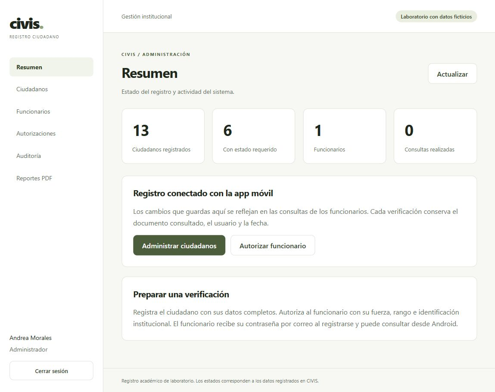
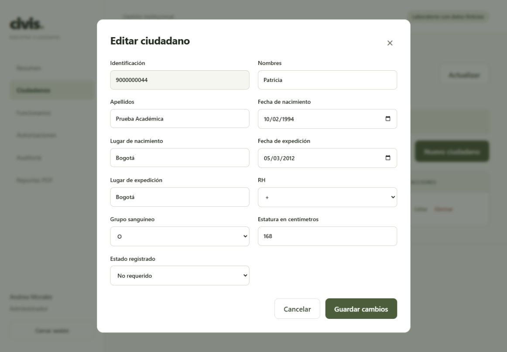
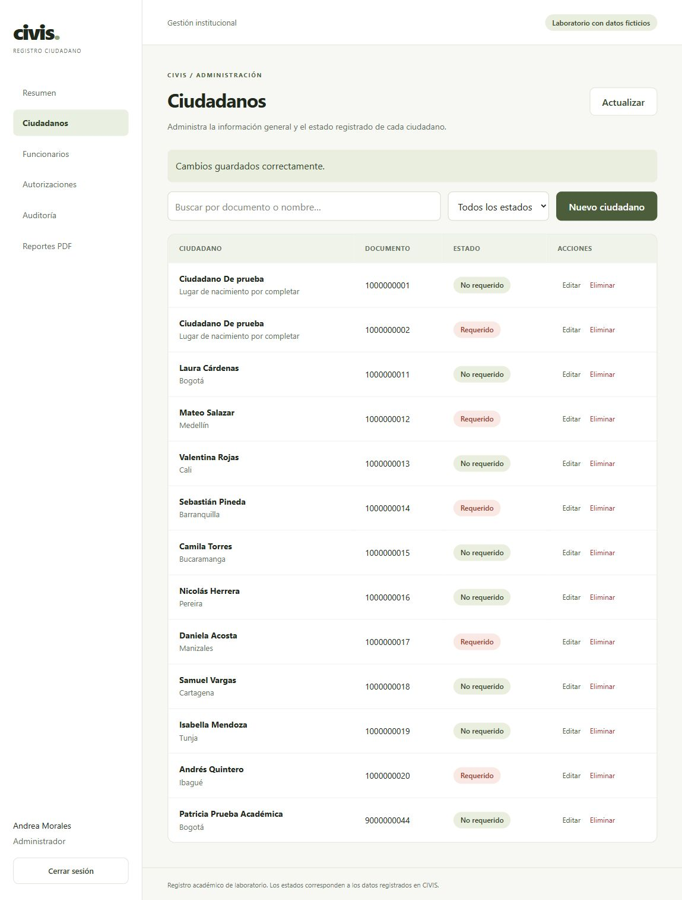
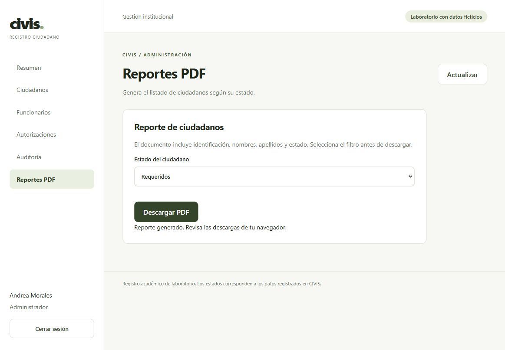
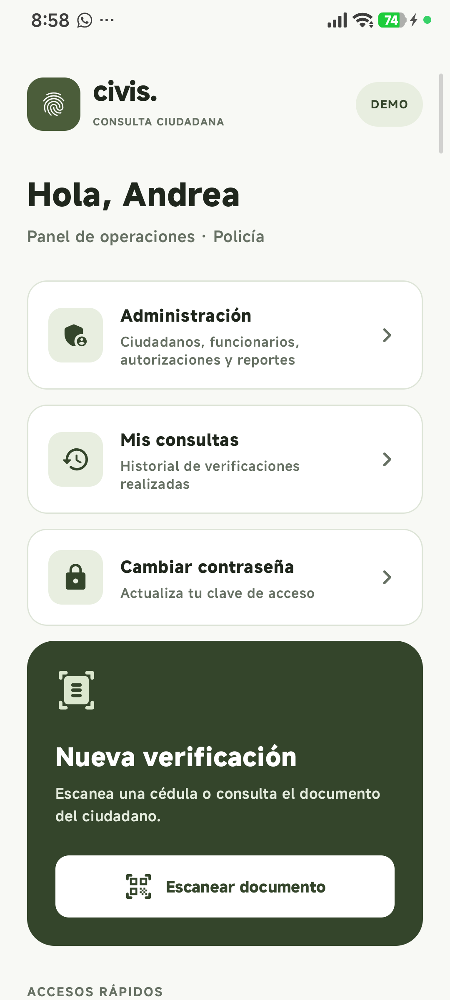
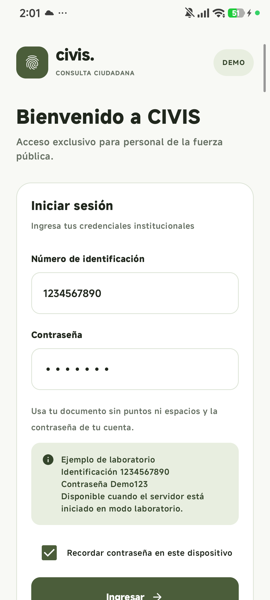
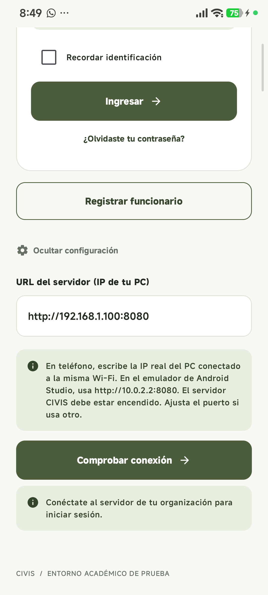

# CIVIS Sistema de consulta ciudadana

Entrega académica de Ingeniería de Software I para la Fundación Universitaria Konrad Lorenz. Incluye portal web, aplicación Android y API REST con PostgreSQL, Hibernate y Tomcat.

**Equipo:** Jorge Alejandro López Páez, David Santiago Guerrero Tolosa, Daniel Felipe Bejarano Perez y Juan Sebastian Romo Sanabria. Los cargos están pendientes de acordarse.

## Avance móvil de diez minutos

El material para la revisión actual se centra en la app Android y presenta a los cuatro integrantes del equipo.

- [Presentación PowerPoint con ocho diapositivas](docs/avance-movil/CIVIS_Avance_Movil_10min.pptx).
- [Diapositivas en PDF](docs/avance-movil/CIVIS_Avance_Movil_10min.pdf).
- [Guion breve para diez minutos](docs/avance-movil/Guion_Avance_Movil_10min.pdf).
- [Guion ampliado y pasos de la demostración](docs/avance-movil/Guion_10_minutos.md).

La documentación de cierre incluida más adelante corresponde a una propuesta académica simulada. Las pruebas y capturas corresponden a verificaciones realizadas sobre la implementación.

## Iniciar el laboratorio

Requiere JDK 26, Maven 3.9+, Docker Desktop activo y Android Studio con SDK 36 para compilar el móvil.

```powershell
$env:JAVA_HOME='C:\Program Files\Java\jdk-26.0.1'
$env:DB_PASSWORD='<elige una contraseña local>'
.\iniciar-laboratorio.ps1
```

El script inicia PostgreSQL y Mailpit, compila la API y deja el backend ejecutándose en la terminal. Para usar un JAR ya compilado, añade `-OmitirCompilacion`. Conserva la misma `DB_PASSWORD` cuando reinicies una base existente.

- Portal administrativo en `http://localhost:8081`.
- Estado de la API en `http://localhost:8081/api/health`.
- Correo de laboratorio en `http://localhost:8025`.
- PostgreSQL de Docker en `localhost:5433` para evitar conflictos con instalaciones locales. `DB_PORT` permite cambiarlo.

En laboratorio, el administrador ficticio usa documento `1234567890` y contraseña `Demo123`. El perfil `lab` habilita estas cuentas y datos. El modo predeterminado del backend requiere configurar un administrador propio para una base vacía.

En Android Studio abre **la carpeta `android`**, sincroniza y ejecuta `app`. En un teléfono usa `http://IP_DEL_PC:8081` en la misma Wi-Fi. En el emulador utiliza `http://10.0.2.2:8081`. Para USB puedes ejecutar `adb reverse tcp:8081 tcp:8081` y configurar `http://127.0.0.1:8081`.

## Funcionalidad

El portal web administra las fichas completas de ciudadanos, sus estados, las autorizaciones institucionales y los permisos de funcionarios. Incluye búsqueda, filtros, auditoría paginada y descarga de PDF.

Android permite registro autorizado con correo y contraseña temporal, login, recuerdo opcional de contraseña cifrada con Android Keystore, recuperación, consulta manual y lectura de códigos con Google Code Scanner. El operador confirma el documento antes de consultar. Las respuestas distinguen `REQUERIDO`, `NO_REQUERIDO` y `SIN_DATOS`.

La API centraliza las reglas y valida los roles `ADMIN` y `OFFICER`. Guarda contraseñas con BCrypt y hashes de los tokens de sesión. La recuperación, el cambio de clave, el cierre de sesión y la modificación de permisos revocan sesiones.

## Registro de ejemplo

El administrador debe autorizar previamente documento, fuerza, rango, ID y correo. El laboratorio incluye esta autorización ficticia.

- Documento `1111111111`.
- Nombres `Juan Carlos` y apellidos `Pérez Gómez`.
- Fuerza `Policía` y rango `Patrullero`.
- ID institucional `POL-101` y correo `funcionario@civis.test`.

La clave temporal llega al buzón de Mailpit del PC. Si el documento ya está registrado, utiliza recuperación de acceso. Los ciudadanos ficticios `1000000011` a `1000000020` permiten probar consultas. Los dos identificadores originales `1000000001` y `1000000002` se conservan por compatibilidad.

## Documentación y presentación

- [Entrega corregida según HU12 oficial: arquitectura, prototipo, modelo, pruebas y configuración](docs/proyecto/HU12_entrega.md).

- [Informe de dirección y diseño](docs/proyecto/01_Informe_del_proyecto.md) con alcance, equipo, planeación, trazabilidad, arquitectura, seguridad, pruebas y riesgos.
- [Manual de uso y despliegue](docs/proyecto/02_Manual_de_uso_y_despliegue.md).
- [Guion del líder y preparación de la sustentación](docs/proyecto/03_Guion_del_lider_y_sustentacion.md).
- [Diagramas editables de arquitectura, datos y secuencia](docs/proyecto/diagramas.md).
- [Documentos Word, PDF y presentación PowerPoint](docs/entrega/).
- [Resultados de 27 comprobaciones integrales](docs/proyecto/verificacion.json).
- [Verificación móvil de login y recuerdo cifrado](docs/proyecto/verificacion_android.json).

El paquete local `entrega/CIVIS_Entrega_Completa.zip` reúne fuentes, JAR, APK debug, scripts de base de datos, documentos y evidencias. Esa carpeta se excluye de Git para conservar el repositorio de fuentes y documentación.

## Evidencias de la aplicación

### Portal web

Capturas del 17 de noviembre de 2026 con PostgreSQL aislado y datos ficticios. El alta y la edición de la ficha se comprobaron desde el navegador.

<p>
  
  
</p>

<p>
  
  
</p>

### Inicio de sesión y registro móvil

Las primeras capturas muestran la versión de laboratorio del 15 de noviembre de 2026. La última evidencia documenta la versión del 17 de noviembre con la contraseña cifrada recuperada después de reiniciar la app.

<p>
  
  
  
</p>

### Sesión iniciada con usuario de laboratorio

La cuenta ficticia Andrea Morales corresponde al documento `1234567890`, fuerza Policía y perfil administrador. La captura original utilizó un backend de laboratorio con H2 temporal por USB. El 17 de noviembre también se verificó login móvil contra PostgreSQL, cifrado Keystore y restauración después del reinicio.

<p>
  
  
</p>

### Recuperación y servidor

<p>
  
  
</p>

La captura histórica de configuración muestra el puerto 8080. El script actual inicia CIVIS en 8081. La verificación aislada de entrega utilizó 8082.

## Base de datos y compilación

`database/01_schema.sql` crea tablas e índices en PostgreSQL. `02_demo_citizens.sql` carga diez registros ficticios sin sobrescribir los existentes. Docker aplica el esquema solamente al crear un volumen nuevo. La carga de cuentas del perfil `lab` genera los hashes desde Java.

```powershell
cd backend
mvn test package
cd ..\android
.\gradlew.bat :app:assembleDebug :app:lintDebug
```

La app usa Gradle 9.6.0, AGP 9.2.0 y bytecode JVM 17. El backend usa Java 26. `iniciar-servidor.ps1 -Puerto 8081` permite ejecutar el JAR con servicios existentes configurados mediante `DB_URL`, `DB_USER`, `DB_PASSWORD` y variables `SMTP_*`.

## Verificación y supuestos

Se aprobaron 27 casos contra PostgreSQL 18 aislado y un receptor SMTP local, incluyendo entrega de contraseña, login, perfiles, CRUD, auditoría, recuperación y PDF filtrado. Las dos pruebas JUnit y las tareas Android de compilación y lint completaron correctamente. La opción de recordar contraseña se verificó en un Redmi Note 14 con almacenamiento cifrado y restauración tras reinicio.

La consulta institucional se representa mediante el padrón académico `defense_registry`. La guía permite documentar supuestos, cuya aceptación corresponde al profesor. El ensayo de cámara con una cédula física permanece pendiente. Docker Compose propone PostgreSQL 17 y Mailpit, mientras que la verificación local utilizó PostgreSQL 18 y un receptor SMTP de pruebas.

Los estados proceden del registro ficticio o interno de CIVIS. Una integración institucional requiere proveedor autorizado, credenciales, HTTPS y políticas operativas. Para uso interno sin datos ficticios, utiliza una base separada, omite el perfil de laboratorio y configura `CIVIS_ADMIN_ID`, `CIVIS_ADMIN_EMAIL` y `CIVIS_ADMIN_PASSWORD`.
