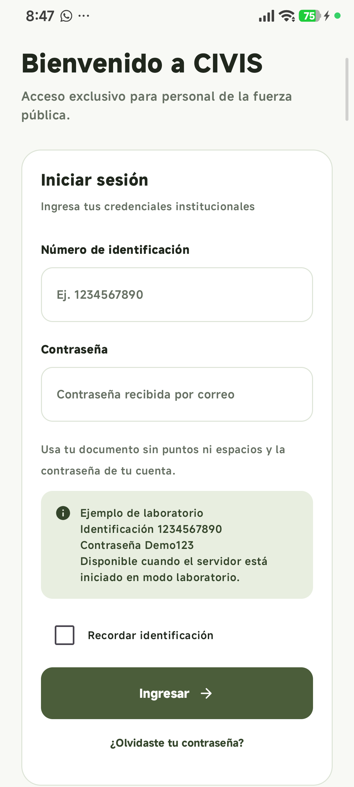
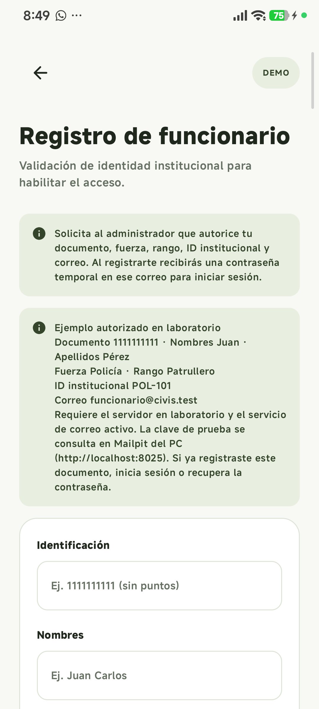
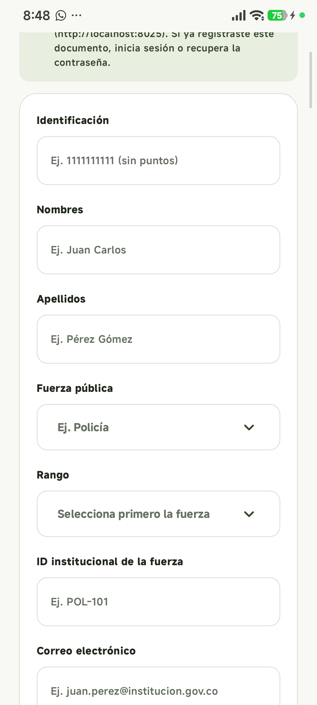
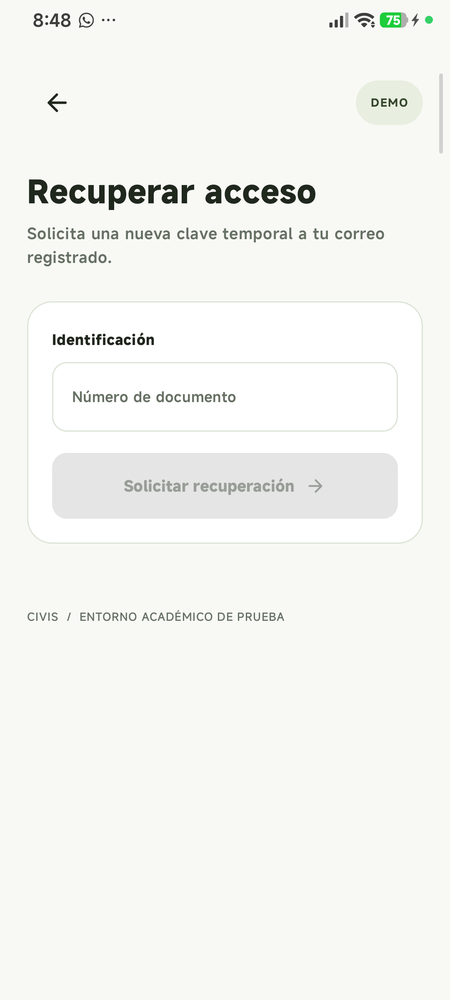

# CIVIS · Edición Minimal Militar (Kotlin + Java 26 + PostgreSQL)

## Qué contiene esta entrega

- **android/**: aplicación Android en Kotlin/Jetpack Compose, completamente rediseñada con verde militar, superficies blancas y minimalismo. Incluye login, registro con fuerza/rango dinámico, recuperación, home, lector de código de barras, consulta por identificación, resultado con nombre obtenido de la base de datos y perfil.
- **backend/**: API REST en Java 26/Spring Boot, PostgreSQL con JPA/Hibernate, usuarios, validación institucional **simulada**, contraseñas BCrypt, sesiones, auditoría, PDF administrativo y SMTP de laboratorio.
- **database/**: CSV de los 10 ciudadanos ficticios precargados (identificaciones 1000000011–1000000020).
- **docker-compose.yml**: PostgreSQL y Mailpit.

**Verificación local** realizada el 15 de noviembre de 2026. La app compiló con `:app:assembleDebug`, pasó `:app:lintDebug` y se instaló en un Redmi Note 14. Las dos pruebas del backend pasaron con `mvn test`, usando H2 y correo simulado. El acceso desde el teléfono requiere completar la configuración de PostgreSQL, correo y URL del servidor.

## Evidencias de la aplicación

Capturas reales de CIVIS en un Redmi Note 14, tomadas el 15 de noviembre de 2026. Los ejemplos visibles corresponden al entorno de laboratorio.

### Inicio de sesión

Formulario de acceso con ejemplos de identificación y credenciales de laboratorio.



### Registro de funcionario

Instrucciones de autorización previa y formulario con ejemplos de documento, nombres, apellidos, fuerza, rango, ID institucional y correo. Las dos capturas muestran distintas posiciones de desplazamiento de la misma pantalla.

<p>
  
  
</p>

### Recuperación de acceso

Solicitud de contraseña temporal mediante el documento del funcionario registrado.



### Configuración del servidor

Dirección de ejemplo, instrucciones para teléfono y emulador, y botón para comprobar la conexión con CIVIS.


## Inicio rápido en Windows 11

1. Abre Docker Desktop. En PowerShell, desde esta carpeta, configura `$env:DB_PASSWORD='<tu contraseña local>'` y ejecuta `docker compose up -d`. Usa esa misma variable en la terminal del backend.
2. Comprueba que `java -version` indique Java 26, que `mvn -version` esté disponible y ejecuta `cd backend; mvn spring-boot:run`.
3. En el PC abre `http://localhost:8080/api/health` para confirmar que responde la API.
4. En Android Studio selecciona **File > Open** y abre **únicamente la carpeta `android`** (dentro está `settings.gradle.kts`). En terminal de esa carpeta ejecuta `powershell -ExecutionPolicy Bypass -File .\preparar-gradle.ps1` si faltan `gradlew.bat` y `gradle-wrapper.jar`. El script requiere conexión a Internet.
5. Selecciona JDK 26 como *Gradle JDK*, sincroniza, elige la configuración `app` y el Redmi Note 14; pulsa **Run**. El código móvil se compila con objetivo JVM 17 por compatibilidad de Android, aunque Gradle corre con Java 26.
6. PC y teléfono deben compartir la misma Wi-Fi. En el login pulsa **Configurar servidor API**, introduce `http://IP_DE_TU_PC:8080` (obtén la IPv4 de Windows con `ipconfig`) y usa `1234567890` / `Demo123`.
7. Consulta `1000000011` a `1000000020`, datos totalmente ficticios precargados automáticamente en PostgreSQL cuando está activo `DEMO_MODE=true`.

**Si aparece error de instalación por USB en Xiaomi**: habilita `Instalar vía USB` en las opciones de desarrollador. El servidor debe estar arrancado para que el inicio de sesión funcione.

## Cambios con respecto a CIVIS v2

- Nueva identidad visual **Olive / Military Green** en *todas* las pantallas.
- Diseño sin azules, sin gradientes y sin Glassmorphism: componentes más sobrios, consistentes y accesibles.
- La consulta `GET /api/citizens/{id}/status` ahora incluye el campo `name` cuando existe un ciudadano ficticio. La aplicación muestra ese nombre real **de la base demo**, no un nombre local inventado. El resto de campos de la respuesta se preserva.
- Los estados siguen siendo `REQUERIDO`, `NO_REQUERIDO` y `SIN_DATOS` y están rotulados como demostración.

## Alcance y limitaciones

Todos los datos de ciudadanos y funcionarios provienen de un entorno de laboratorio; no usarlos para decisiones reales. No introduzcas identificaciones reales. La app requiere un backend ejecutándose en tu computadora; no funciona de forma autónoma sin red. El escaneo PDF417 exige que un operador confirme el número de identificación. El módulo administrativo está expuesto mediante endpoints REST, **no** mediante una interfaz web. En producción haría falta HTTPS, control institucional verificado, endurecimiento de seguridad, migraciones y pruebas.

---

## Documentación técnica de la versión base

# CIVIS v2 — Android Kotlin + Java 26 + PostgreSQL

Este proyecto amplía la app móvil anterior y agrega un backend REST y una base de datos real. **CIVIS no está conectado a sistemas oficiales**. Es un proyecto académico con funcionarios y ciudadanos ficticios.

## Arquitectura

```text
Redmi Note 14 (app Android Kotlin / Jetpack Compose)
    |  HTTP en LAN de laboratorio / HTTPS al desplegar
    v
Servidor Java 26 (Spring Boot 4.0.9, API REST)
    |                  |
    v                  v
PostgreSQL 17        Mailpit SMTP (correo de prueba)
    |
    +-- officers: usuarios, hash BCrypt, perfil y rol
    +-- defense_registry: padrón simulado de validación
    +-- citizens: datos generales + estado requerido/no requerido
    +-- auth_sessions: tokens con hash SHA-256 y expiración
    +-- lookup_audit: trazabilidad de consultas
```

**Importante sobre Java 26 y Android:** el backend usa código fuente Java 26 y Gradle para Android se ejecuta con JDK 26. La app móvil está escrita en Kotlin y genera bytecode JVM 17 compatible con Android, porque los teléfonos Android no ejecutan directamente Java SE 26. No afirmamos que el APK sea bytecode Java 26.

## Preparación en Windows 11

Requisitos: Android Studio con SDK 36, JDK 26, Maven 3.9+, Docker Desktop con motor activo, teléfono y PC en **la misma red Wi-Fi**.

### A. Levantar PostgreSQL + correo de prueba

Abre PowerShell en la carpeta principal (`CIVIS_FULLSTACK_JAVA26`):

```powershell
docker compose up -d
```

PostgreSQL queda en `localhost:5432`, usuario `civis`, base de datos `civis`. Antes de ejecutar Docker, configura `$env:DB_PASSWORD='<tu contraseña local>'` y conserva la misma variable en la terminal del backend. Mailpit queda en `http://localhost:8025` y recibe los emails enviados a su SMTP local `localhost:1025` **sin enviar ningún correo real a Internet**. No publiques estos puertos.

### B. Iniciar el servidor Java 26

En otra terminal:

```powershell
java -version  # Debe decir 26
cd backend
mvn spring-boot:run
```

> Si `mvn` no existe, instala Apache Maven 3.9+ y vuelve a abrir PowerShell. El archivo `backend/pom.xml` define todas las dependencias.

Prueba en el navegador del PC `http://localhost:8080/api/health`; debe devolver `{"status":"UP","demo":true}`. También puedes ejecutar `./probar-api.ps1` desde la carpeta principal para probar acceso y consultas por REST.

### C. Averiguar IP del PC

En una terminal de Windows ejecuta:

```powershell
ipconfig
```

Busca la dirección **IPv4 de tu adaptador Wi-Fi**, por ejemplo `192.168.1.23`. En el móvil NO debes poner `localhost`: `localhost` significa el propio teléfono. El firewall de Windows puede pedir que autorices Java en redes privadas; permite solo **red privada de confianza**.

### D. Abrir Android en Android Studio

1. Desde Android Studio, **File > Open > android** (la carpeta que contiene `settings.gradle.kts`).
2. Dentro de `android`, ejecuta una sola vez:

```powershell
powershell -ExecutionPolicy Bypass -File .\preparar-gradle.ps1
.\gradlew.bat :app:assembleDebug
```

3. Configura **Gradle JDK = JDK 26**, sincroniza y selecciona `app` + tu Redmi Note 14.
4. Pulsa **Run**. En la pantalla de login CIVIS, cambia el campo **Servidor API** a `http://IP_DEL_PC:8080` (ejemplo `http://192.168.1.23:8080`). Guarda la URL simplemente editando el campo. PC y móvil deben compartir red.

El HTTP sin TLS está permitido **solo en la compilación debug** mediante `android/app/src/debug/AndroidManifest.xml`. La compilación release lo bloquea: usa HTTPS para un despliegue real.

### Credenciales y consultas ficticias

- Identificación: `1234567890`
- Contraseña: `Demo123`
- Tipo de usuario demo: `ADMIN` (para probar API de gestión, **no para producción**)
- `1000000001`: NO REQUERIDO (ficticio)
- `1000000002`: REQUERIDO (ficticio)
- Otros documentos: SIN_DATOS.

El usuario de demostración se crea **solo** con `DEMO_MODE=true`. Se ejecuta contra PostgreSQL, no contra un Map o almacenamiento en memoria en Android.

### Registro con validación en el padrón simulado

El backend carga un registro **ficticio** de funcionario autorizado (exclusivamente para pruebas):

| Campo | Valor |
|---|---|
| Identificación | `1111111111` |
| Nombre | Puedes registrar nombres y apellidos de prueba |
| Fuerza | `Policía` |
| Rango | `Patrullero` |
| ID Fuerza | `POL-101` |
| Correo | `funcionario@civis.test` |

Cuando el usuario se registra, el backend coteja identificación, fuerza, rango, ID y correo con `defense_registry`. Si coinciden, genera una contraseña temporal de **6 caracteres**, que incluye mayúscula, minúscula y número, almacena solo un **hash BCrypt** y envía un mensaje a **Mailpit**. Lee el correo en `http://localhost:8025`. Esto simula la verificación institucional; **no existe integración con una base real de Defensa**.

La recuperación envía otro correo de prueba sin revelar si la identificación existe. La app permite iniciar sesión y consultar con un token de sesión temporal. La sesión se conserva **solo en memoria** en el teléfono y se elimina al cerrar la app; la identificación recordada y la URL se guardan en preferencias, pero la contraseña nunca se guarda.

## API REST

| Método | Ruta | Uso / permiso |
|---|---|---|
| GET | `/api/health` | Salud del servidor |
| POST | `/api/auth/register` | Registro con padrón simulado + Mailpit |
| POST | `/api/auth/login` | Inicio de sesión; devuelve token y perfil |
| POST | `/api/auth/recover` | Recuperación por correo |
| POST | `/api/auth/change-password` | Cambio de clave; requiere token |
| POST | `/api/auth/logout` | Revoca sesión |
| GET | `/api/auth/me` | Datos del usuario autenticado |
| GET | `/api/citizens/{id}/status` | Consulta autentificada y registro de auditoría |
| POST | `/api/admin/citizens` | Alta o actualización de ciudadanos; rol ADMIN |
| GET | `/api/admin/citizens?required=true` | Reporte filtrado JSON; rol ADMIN |
| GET | `/api/admin/report.pdf?required=true` | Reporte PDF filtrado; rol ADMIN |

La administración se hace **por REST, no mediante una interfaz web**, para respetar que el encargo inicial era solo la parte móvil. Si te piden una interfaz administrativa web, aún falta desarrollarla.

**Ejemplo para generar reporte PDF en PowerShell:**

```powershell
$login = Invoke-RestMethod -Uri http://localhost:8080/api/auth/login -Method Post -ContentType 'application/json' -Body '{"identification":"1234567890","password":"Demo123"}'
Invoke-WebRequest -Uri 'http://localhost:8080/api/admin/report.pdf?required=true' -Headers @{Authorization="Bearer $($login.token)"} -OutFile ./reporte-civis.pdf
```

## Cobertura del documento del profesor

- ✅ App nativa Android, Kotlin + Jetpack Compose.
- ✅ Registro de funcionario con los campos exigidos y fuerza/rango dependientes.
- ✅ Validación mediante tabla de padrón **simulada**, no fuente oficial de Defensa.
- ✅ Contraseña temporal de 6 caracteres, remitida a buzón SMTP local en pruebas.
- ✅ Login, recordatorio de identificación y recuperación vía correo de pruebas.
- ✅ Escáner de código de barras y consulta por identificación confirmada por operador.
- ✅ Resultado requerido/no requerido (datos **ficticios** de PostgreSQL).
- ✅ API REST, PostgreSQL y JPA/Hibernate (ORM), servidor Tomcat embebido.
- ✅ Módulo de seguridad: tokens, contraseñas BCrypt y permisos ADMIN/OFFICER.
- ✅ Gestión de ciudadanos vía API y reporte PDF filtrado (aún sin UI administrativa).
- ⚠️ No hay proveedor autorizado de antecedentes ni padrón real; se necesita convenio/acceso oficial para integración.
- ⚠️ Quedan pendientes las pruebas instrumentadas y el endurecimiento de seguridad para producción.

## Seguridad / limitaciones

**Proyecto SOLO para laboratorio.** Los datos de ejemplo no son judiciales y los usuarios son inventados. `DEMO_MODE=true`, credenciales por defecto, HTTP local y sincronización JPA `ddl-auto=update` son apropiados únicamente para práctica. En producción: `DEMO_MODE=false`, HTTPS obligatorio, credenciales de DB secretas y rotadas, migraciones Flyway, control institucional de acceso, auditoría inmutable, gestión de secretos, protección frente a intentos de login, eliminación/retención de datos y pruebas externas. **No despliegues esta versión para consultas oficiales.**

La lectura del PDF417 puede incluir campos múltiples: la app no asume que la cadena de código equivale al número de identificación y solicita confirmación manual. En el documento no se especifica el formato binario concreto de la cédula ni credenciales de APIs oficiales.

**Verificación:** `:app:assembleDebug` y `:app:lintDebug` completados correctamente. Las dos pruebas de backend con `mvn test` finalizaron sin fallos. El APK se instaló en un Redmi Note 14 y las pantallas de acceso se documentan en las evidencias anteriores. La comprobación de login y registro desde el teléfono queda pendiente de configurar el backend con PostgreSQL y SMTP.

## Datos de demostración añadidos (10 ciudadanos)

Esta edición incluye **10 ciudadanos totalmente ficticios** precargados por `backend/src/main/java/com/civis/api/DemoData.java` al arrancar el backend con `DEMO_MODE=true`. Se guardan en PostgreSQL mediante JPA/Hibernate, no solo en el celular. Los IDs para consultar son **1000000011 a 1000000020**. Hay 4 registros marcados REQUERIDO y 6 NO REQUERIDO; estas etiquetas son **datos simulados**, sin relación con antecedentes reales.

También se incluye `database/ciudadanos_ficticios_10.csv` para visualizar los datos. Los 2 IDs originales (1000000001 y 1000000002) siguen funcionando, así que una base nueva tendrá 12 ciudadanos de demostración.

**Carga automática:** no necesitas ejecutar SQL manualmente. Si el backend ya está funcionando, reinícialo (`Ctrl+C`, luego `mvn spring-boot:run`). El cargador comprueba si cada identificación existe antes de insertarla, por lo que no duplica ni sobrescribe registros. No borra los datos ya existentes. Confirma su presencia con `SELECT document_id, first_name, last_name, required FROM citizens ORDER BY document_id;` en PostgreSQL.

**Aviso:** solo para exposición académica. No introduzcas cédulas verdaderas ni afirmes que estos estados son oficiales.
