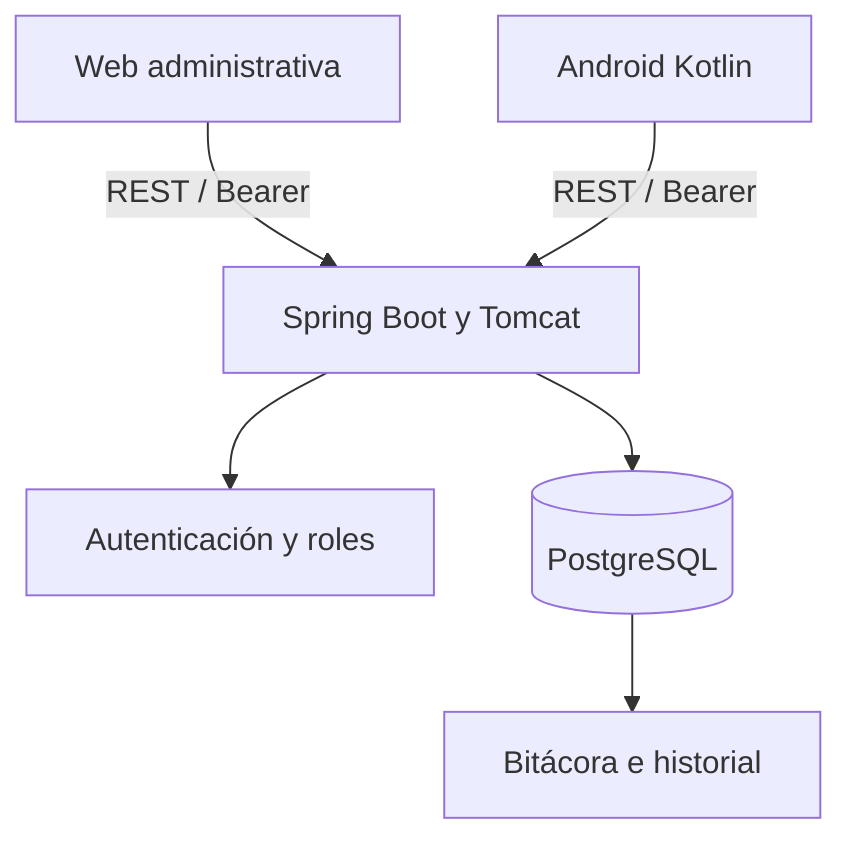
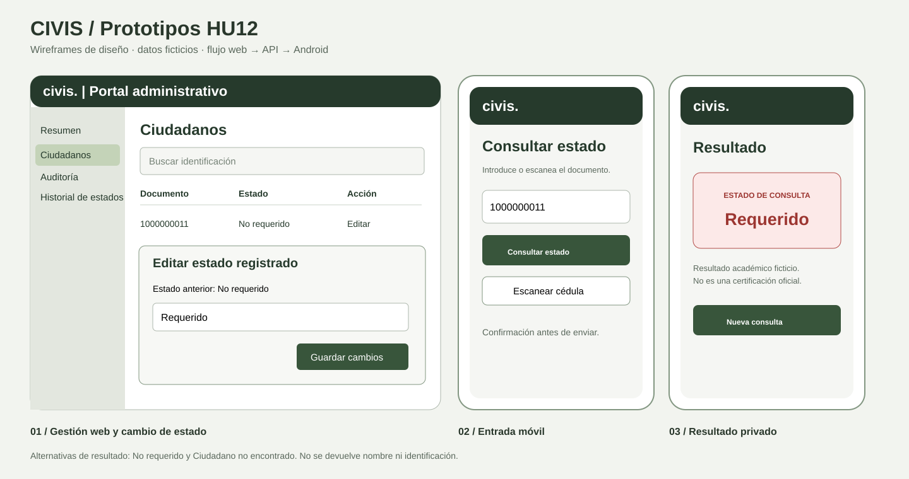
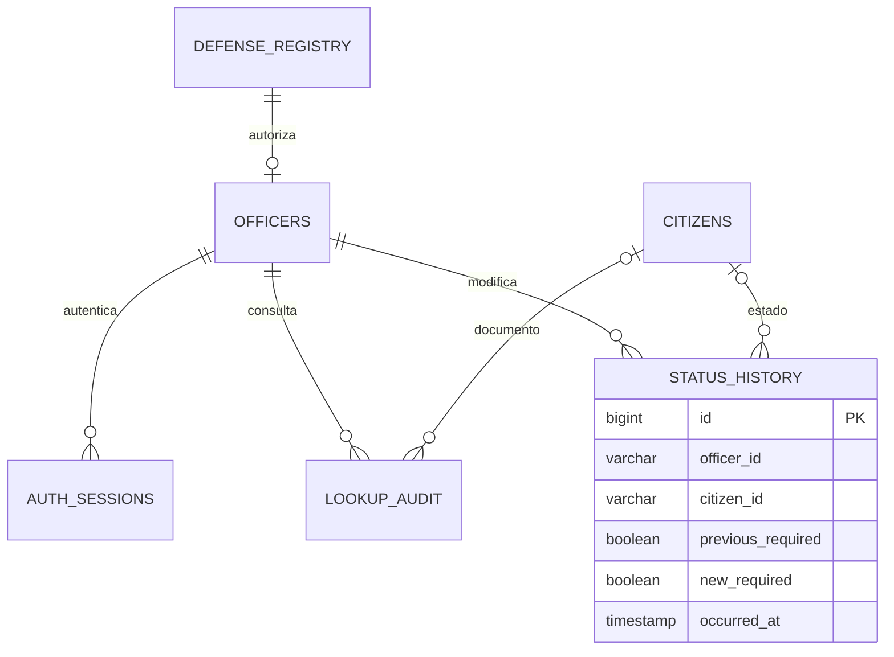

# CIVIS — Entrega HU12 oficial

Fuente: [Scrum-ProyectoFinal, historias de usuario](https://docs.google.com/spreadsheets/d/1avUkCoIfNVRAkM6Vf-d_UuZ0O_R4tVvyRaPLMGgXc7U/edit?gid=1056918100#gid=1056918100). La numeración anterior del backlog es histórica y no corresponde a esta hoja.

## Alcance y arquitectura

HU12: como miembro de la Fuerza Pública, consultar antecedentes para conocer si el ciudadano está requerido. Dependencias: HU5 (administración del estado) y HU6 (REST seguro). Solo datos ficticios; no es una fuente oficial de antecedentes.

HTTP local es exclusivo del laboratorio. HTTPS con certificado válido es requisito pendiente de comprobar en despliegue externo.

## Prototipo funcional de baja fidelidad

| Pantalla web | Pantalla móvil |
|---|---|
| Login → Ciudadanos → Buscar → Ficha → cambiar estado → Guardar | Login → Consulta → Digitar o escanear → Confirmar → Consultar |
| Listado: identificación, nombre, estado y edición (solo ADMIN) | Resultado: Requerido / No requerido / Ciudadano no encontrado; Nueva consulta |
| Auditoría: usuario, fecha y resultado de consultas | Sin nombres, identificación ni otros datos en el resultado |

## Modelo físico y lógico

El [esquema SQL](../../database/01_schema.sql) es la fuente física completa. Para bases existentes aplicar [migración](../../database/03_status_history.sql). Las asociaciones de auditoría son lógicas para conservar historia incluso si se elimina una ficha.

## Plan de pruebas

| ID | Caso | Resultado esperado | Evidencia requerida |
|---|---|---|---|
| CP01 | Consulta requerida con sesión | HTTP 200, solo status REQUERIDO | Prueba REST y pantalla Android |
| CP02 | Cambio en web y consulta posterior | NO_REQUERIDO inmediatamente | Captura web y Android |
| CP03 | Documento inexistente | SIN_DATOS; pantalla Ciudadano no encontrado | REST y Android |
| CP04 | Sin token o token inválido | HTTP 401 | Prueba REST |
| CP05 | Funcionario intenta cambiar estado | HTTP 403 | Prueba REST |
| CP06 | Consultas sucesivas | Bitácora con actor, documento, hora y resultado | Auditoría web |
| CP07 | Cambio de estado | Historial con valor anterior/nuevo, actor y hora | GET /api/admin/status-history |
| CP08 | Medición de tiempo | Respuesta en máximo 5 segundos | Cronometrar en dispositivo |
| CP09 | Canal externo | Certificado HTTPS válido | Prueba en despliegue |

## Ejecución y resultados

La evidencia histórica del 17 de noviembre consta en `verificacion.json` y `verificacion_android.json`; no certifica este cambio. CP01–CP08 tienen comprobaciones REST automatizadas en `ApplicationFlowTest.java` (H2 de pruebas, no PostgreSQL). La validación de interfaz Android, PostgreSQL y HTTPS necesita ejecución en su entorno. El 19 de noviembre se intentó ejecutar Maven, pero no pudo resolver el repositorio de dependencias por DNS; no se ejecutaron casos JUnit. `node --check` sobre el portal y `git diff --check` son verificaciones estáticas, no pruebas funcionales. El flujo CI adjunta informes JUnit y APK/lint cuando finalice. No se declaran aprobados sin ejecución.

## Configuración y demostración

Rama `fix/hu12-entrega-academica`, base `main`. Revisar mediante pull request antes de integrar. No versionar contraseñas ni datos reales. Ejecutar `mvn test` en backend y `./gradlew :app:assembleDebug :app:lintDebug` en Android; iniciar el laboratorio según README. Usar datos ficticios. Cambiar estado en web, consultar el mismo documento desde Android y revisar bitácora e historial. No confundir el laboratorio con despliegue HTTPS.

El alcance de esta rama es HU12 y dependencias inmediatas, no el cierre de las 14 historias oficiales.
