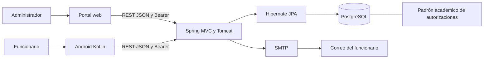
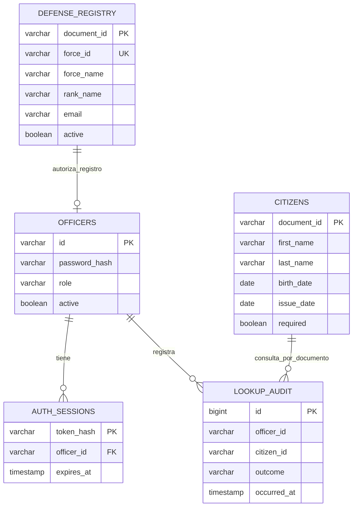
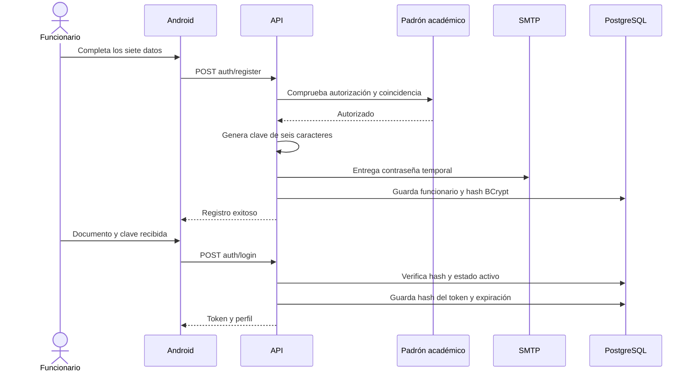
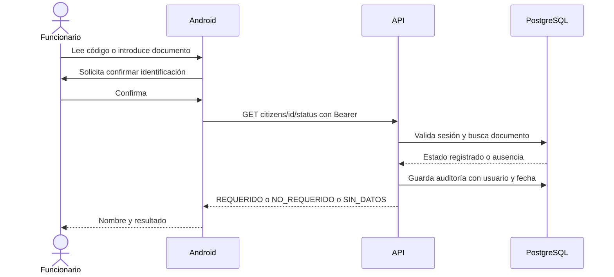

# Diagramas de CIVIS

Los diagramas describen la implementación académica. El padrón institucional es un componente simulado dentro de la base del proyecto.

## Contexto y despliegue

## Modelo entidad relación

La relación de auditoría por documento es lógica. La tabla conserva el documento consultado aun cuando el ciudadano no existe o su ficha se elimina. La asociación entre padrón y funcionario también es lógica. La clave foránea física de sesión sí referencia officers.

## Registro y autenticación

## Consulta y auditoría

